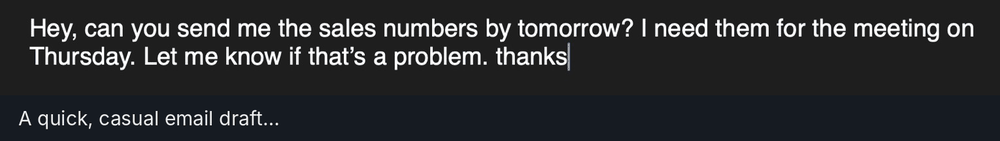
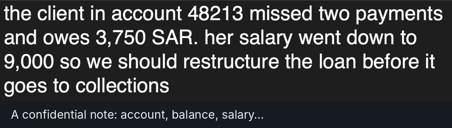
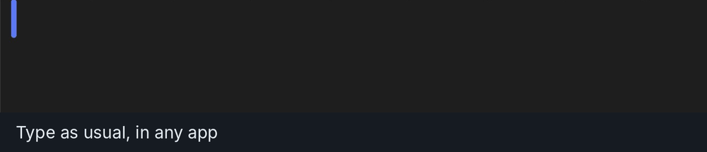
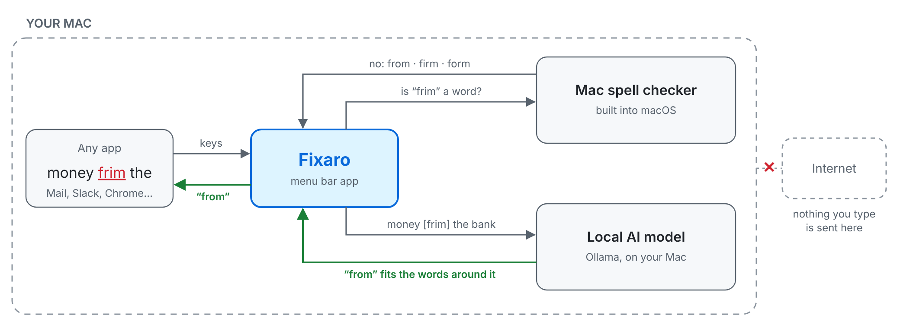

<p align="center">
  
</p>

<h1 align="center">Fixaro</h1>

<p align="center"><b>Private grammar fixing and rewriting for every app on your Mac.<br>Your text never leaves your computer.</b></p>

Online writing assistants send what you write to their servers. Fixaro doesn't: its AI runs on your own Mac, so you can use it on confidential emails, client details, contracts and reports. Select text, press **⌃⌥R**, and get correct grammar in your usual style. Press **⌃⌥S** instead to pick a style or say exactly how you want it rewritten. While you type, it fixes typos too.

<p align="center">
  
</p>

## Private by design

Client details, account numbers, salaries: rewrite them without worrying, because they never leave your Mac.

<p align="center">
  
</p>

- **Your text stays on your Mac.** The AI runs locally through [Ollama](https://ollama.com). No account, no cloud, no tracking, and nothing is sent anywhere.
- **Works offline.** Once your model is downloaded, Fixaro works with the internet switched off.
- **Never sees passwords.** macOS hides password fields from all apps, Fixaro included.
- **Saves nothing you write.** It keeps only your word list, your styles, and a log of the typos it fixed (`~/Library/Application Support/Fixaro/`, `~/Library/Logs/Fixaro.log`). Rephrased text is never saved.
- **Open source.** Anyone can read the code and check exactly what it does.

| | Fixaro | Online writing assistants |
|---|---|---|
| **Where your text goes** | Stays on your Mac | Sent to their servers |
| **Account** | None | Usually required |
| **Works offline** | Yes | No |
| **Price** | Free and open source | Often a monthly subscription |

Good to know: Fixaro needs **Accessibility** permission, the only way a Mac app can read and replace text in other apps. To rephrase, it copies your selection through the clipboard and puts your clipboard back afterwards, so a clipboard manager may keep a copy.

## Better grammar with one shortcut

1. **Select text** in any app: Mail, Slack, Chrome, Notes…
2. **Press ⌃⌥R** (Control-Option-R). Fixaro rewrites it in your usual style.
3. **Or press ⌃⌥S** (Control-Option-S) for a popup next to your text:
   - **Type how you want it**, for example *more formal, and ask for a reply by Sunday*, and press **Return**.
   - **Or pick a style** with its number key or a click.
   - **Return** on an empty box uses your usual style. **Esc** cancels.

Fixaro corrects grammar, spelling and punctuation, rewrites the text, and puts it right back in place. **⌘Z** brings back the original.

**Faster than a chatbot.** With ChatGPT or Claude, you copy your text, switch apps, paste it, ask for a rewrite, wait, copy the answer, switch back and paste it in. With Fixaro you select the text, press ⌃⌥R, and the rewrite appears right where you're typing, in seconds, without your text leaving your Mac.

<picture>
  <source media="(prefers-color-scheme: dark)" srcset="docs/how-rephrase-works-dark.png">
  
</picture>

| Style | You wrote | Fixaro wrote |
|---|---|---|
| **Natural**: a grammar check that keeps your tone | i think we should of finished the report yesterday but we was to busy with other stuff | I think we should have finished the report yesterday, but we were too busy with other things. |
| **Professional** | hey can u send me the Q3 numbers by tmrw? need them for the 10am meeting with Sara | Could you please send me the Q3 numbers by tomorrow? I need them for the 10:00 AM meeting with Sara. |
| **Shorter** | I just wanted to reach out and let you know that I will not be able to attend the meeting that is scheduled for Thursday because I have a doctor's appointment that I cannot move. | I cannot attend Thursday's meeting due to an unavoidable doctor's appointment. |
| **Friendly** | Your payment of 450 SAR is overdue. Pay it by June 5 or your account will be suspended. | Just a friendly heads-up that your payment of 450 SAR is a little overdue. Could you please take care of it by June 5th so your account stays active? |

<sub>Real results from gemma4:e4b on a Mac with 18 GB of memory, about a second each.</sub>

It keeps your names, numbers and meaning, and won't answer your text: a question stays a question.

### Make your own styles

Menu bar icon → **Rephrase style → Add a style…**. Give it a name and say how it should sound. It shows up in the ⌃⌥S popup straight away. Some ideas:

| Name | How it should sound |
|---|---|
| Customer reply | Polite, warm and short, for replying to a customer |
| Slack message | Casual and brief, like a quick message to a teammate |
| Simple English | Clear and simple, easy for non-native speakers to read |

To change or delete styles, choose **Edit my styles…**. They're kept in one text file, one style per line: `Name: how it should sound`.

To change your usual style (the one ⌃⌥R uses), pick it under **Rephrase style**.

### Only want the grammar and rewriting?

Untick **Fix typos as I type** in the menu bar. ⌃⌥R keeps working, Fixaro leaves your typing alone, and only the rephrase model is loaded.

## Fix typos as you type

<p align="center">
  
</p>

- **Works everywhere:** Mail, Notes, Slack, Chrome, WhatsApp, and more.
- **Understands context.** "the money **frim** the bank" → **from**, but "the new **frim** policy" → **firm**.
- **Learns from you.** Undo the same fix twice and Fixaro leaves that word alone; keep a fix twice and it's applied instantly next time.
- **Easy undo.** Press Backspace right after a fix, or **⌃⌥Z**.

## Install

You need **macOS 14 or later**, on Apple Silicon or Intel. It takes about 5 minutes.

### 1. Get Ollama

Ollama is the free app that runs the AI on your Mac.

1. Download it from [ollama.com/download](https://ollama.com/download).
2. Open the downloaded file. If you get a .zip, double-click it first.
3. Move **Ollama** into **Applications** and open it. If it offers to install its command line tool, click **Install**.

### 2. Install Fixaro

Open **Terminal** (press **⌘ Space**, type `Terminal`, press **Return**) and paste this line:

```bash
git clone https://github.com/Z2mjeed-prog/Fixaro.git && bash Fixaro/build.sh
```

It downloads Fixaro, builds it on your Mac, puts it in the Applications folder inside your home folder, and opens it. If macOS asks to install Apple's developer tools first, click **Install**, wait until it finishes, then paste the same line again.

To update later: `cd Fixaro && git pull && bash build.sh`

<details>
<summary>Prefer a download? Use the .dmg instead</summary>

1. Download **Fixaro-x.y.z.dmg** from the [latest release](https://github.com/Z2mjeed-prog/Fixaro/releases/latest), under **Assets**. The "Source code" files are not the app.
2. Double-click it and drag the Fixaro icon onto the Applications folder.
3. Open Fixaro from Applications. The first time only, macOS says it can't check Fixaro: click **Done**, open **System Settings → Privacy & Security**, and click **Open Anyway**.
</details>

### 3. Finish in the welcome window

Fixaro opens a welcome window:

- **Allow…** asks macOS to let Fixaro work in other apps. Click **Open System Settings**, and switch **Fixaro** on.
- **Download** gets the right AI model for your Mac's memory (about 3 to 4 GB).

That's it. The **F** in your menu bar means Fixaro is on. Select a sentence anywhere and press **⌃⌥R** to try it.

### Which model should I use?

It depends on your Mac's memory (Apple menu → **About This Mac** → Memory):

| Your Mac's memory | Fixing typos | Rephrasing |
|---|---|---|
| **8 GB** | `nemotron-3-nano:4b` (2.9 GB) | the same model |
| **16 GB** | `qwen3.5:4b` (4 GB) | the same model |
| **18 GB or more** | `qwen3.5:4b` (4 GB) | `gemma4:e4b` (9.6 GB): better writing |

- **The welcome window's Download button** gets the typo model for your Mac.
- **To add the rephrasing model** on 18 GB or more: menu bar → **Settings → Download a model…**, then type `gemma4:e4b`.
- **Fixaro picks the right one for each job automatically.** You can change them any time under **Settings → Word-fix model / Rephrase model**.

Want to try others? See the [model test results](docs/MODELS.md).


## Using it

| You want to… | Do this |
|---|---|
| Fix typos | Just type. Fixes happen after Space or Enter |
| Undo a fix | Backspace right after it, or **⌃⌥Z** |
| Rephrase text | Select it, press **⌃⌥R** |
| Choose a style, or say how to rewrite it | Select it, press **⌃⌥S** |
| Add your own style | Menu → **Rephrase style** → **Add a style…** |
| Change models | Menu → **Word-fix model** / **Rephrase model** |
| Never correct a word | Menu → **Edit word list…** |
| Turn it off in some apps | Menu → **Turn off in apps** |
| Rephrase only, no autocorrect | Menu → untick **Fix typos as I type** |
| Pause everything | Menu → **Pause** |

Terminal and code editors are off by default. Fixaro also works with LM Studio, Jan and other local AI apps ([how](docs/MODELS.md#use-another-ai-app-instead-of-ollama-beta)).

## Troubleshooting

- **Turn off macOS's own autocorrect** (System Settings → Keyboard → Text Input → Edit), so two autocorrects don't clash.
- **Menu bar icon shows ⚠:** Fixaro lost its permission. After every rebuild, switch it off and on again under Accessibility.
- **Rephrase does nothing:** make sure Ollama is running and some text is selected.
- **Anything odd:** menu → **Open log** shows every fix and why it was made.

## Known limitations

- **English only.** Arabic and other non-Latin text is left alone.
- **Real-word mistakes aren't caught** (their/there). Use Rephrase for those.
- **The first word after you click somewhere** may be skipped in some apps.

## Uninstall

Paste this into Terminal:

```bash
osascript -e 'quit app "Fixaro"'
rm -rf /Applications/Fixaro.app ~/Applications/Fixaro.app ~/Library/Application\ Support/Fixaro ~/Library/Logs/Fixaro.log
defaults delete io.github.z2mjeed-prog.fixaro; tccutil reset Accessibility io.github.z2mjeed-prog.fixaro
```

It removes the app, your word list and styles, its settings, and its Accessibility permission. If you turned on **Start at login**, also remove Fixaro under **System Settings → General → Login Items**.

## How it works

Rephrasing is pictured [above](#better-grammar-with-one-shortcut). Typo fixing works like this:

<picture>
  <source media="(prefers-color-scheme: dark)" srcset="docs/how-it-works-dark.png">
  
</picture>

Fixaro is a single Swift file (`Sources/main.swift`). The macOS spell checker spots the typo, a local model picks the fix from the words around it (falling back to the spell checker if the model is slow), and the word is swapped in place, or retyped in Chrome and Electron apps. Rephrase copies your selection, rewrites it with the rephrase model, pastes it back and restores your clipboard.

## Roadmap

- Windows version (in progress)
- Catching real-word mistakes (their/there)
- Signed and notarized by Apple, so macOS opens it without the extra step

## Contributing

Issues and pull requests are welcome. If something doesn't work, please open an issue with the relevant lines from the log.

## License

[MIT](LICENSE) © Z2mjeed-prog
